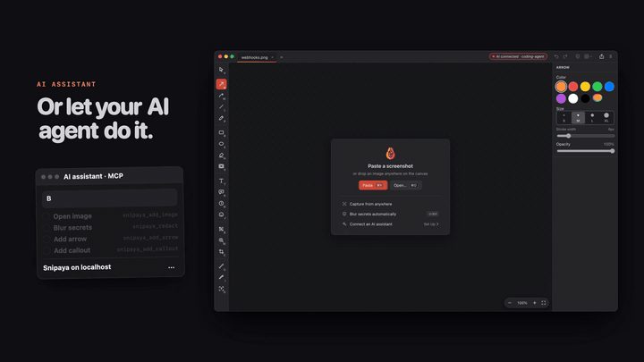

<p align="center">
  
</p>

<h1 align="center">snipaya-mcp</h1>

<p align="center">
  <a href="https://github.com/krzysztofsurdy/snipaya-mcp/actions/workflows/ci.yml"></a>
  <a href="https://www.npmjs.com/package/snipaya-mcp"></a>
  <a href="https://github.com/krzysztofsurdy/snipaya-mcp/blob/main/LICENSE"></a>
</p>

Connect any MCP client that speaks stdio to [Snipaya](https://snipaya.app), the image and screenshot annotator for macOS. Your assistant can read the canvas, add arrows, text, shapes and callouts, redact sensitive data, crop, and export, while you watch the result in Snipaya.

Snipaya has an MCP server built in, served over Streamable HTTP on `127.0.0.1`. `snipaya-mcp` is a thin bridge for clients that only start local stdio servers: it forwards every MCP message between the client and Snipaya, unchanged.

Tools and prompts are listed even before Snipaya is open. Until Snipaya answers, the bridge lists them from a built-in catalog, and a tool call returns a message that says what to do.

<!-- Demo GIF: replace with docs/demo.gif once recorded -->
<!--  -->

## Requirements

- [Snipaya](https://snipaya.app) for macOS. It comes with a 14-day free trial.
- Node.js 20 or newer (for the `npx` setup).

## Turn on the MCP server in Snipaya

The server is off by default.

1. Open Snipaya, then **Settings > AI Assistants**.
2. Turn on **Allow AI assistants**. The status changes to **Running**.

That is all the bridge needs. It reads the access token and port from the settings Snipaya saves on this Mac, so you do not have to copy them.

## Setup

### npx

```sh
npx -y snipaya-mcp
```

If Snipaya is not running but **Allow AI assistants** is on, the bridge opens Snipaya in the background and waits up to 10 seconds for its server.

To override what Snipaya saved, set these variables or flags. Flags win over variables, and variables win over the saved settings.

| Variable | Flag | Default | |
| --- | --- | --- | --- |
| `SNIPAYA_MCP_TOKEN` | `--token` | Token Snipaya saved | Access token from **Settings > AI Assistants**. |
| `SNIPAYA_MCP_URL` | `--url` | `http://127.0.0.1:<saved port>/mcp`, else `http://127.0.0.1:47321/mcp` | Server URL from Snipaya. Only `127.0.0.1` and `localhost` are accepted. |
| `SNIPAYA_MCP_NO_LAUNCH` | | | Set to `1` to never open Snipaya. While Snipaya is closed, tool calls then return `Cannot reach Snipaya`. |

Prefer the environment variable over `--token`: command-line flags are visible to other processes on the Mac.

### JSON config

For clients configured with an `mcpServers` JSON file:

```json
{
  "mcpServers": {
    "snipaya": {
      "command": "npx",
      "args": ["-y", "snipaya-mcp"],
      "env": {
        "npm_config_registry": "https://registry.npmjs.org/"
      }
    }
  }
}
```

For a custom setup, pass the values in `env` instead:

```json
{
  "mcpServers": {
    "snipaya": {
      "command": "npx",
      "args": ["-y", "snipaya-mcp"],
      "env": {
        "npm_config_registry": "https://registry.npmjs.org/",
        "SNIPAYA_MCP_TOKEN": "<access token>",
        "SNIPAYA_MCP_URL": "<server url>"
      }
    }
  }
}
```

If your client supports Streamable HTTP servers directly, you do not need this bridge: use **Copy MCP config** in Snipaya instead.

### MCP Bundle (.mcpb)

1. Download `snipaya-mcp-<version>.mcpb` from the [latest release](https://github.com/krzysztofsurdy/snipaya-mcp/releases/latest).
2. Open it with an MCP client that supports MCP Bundles, or drag it into the client's extensions settings.
3. Leave the token and URL empty to use what Snipaya saved, or paste the values from **Settings > AI Assistants** for a custom setup.

## Security model

- **Local only.** Snipaya's server listens on `127.0.0.1` and accepts only loopback `Host` headers and requests without an `Origin` header, so websites in your browser cannot reach it. The bridge refuses any URL whose host is not `127.0.0.1` or `localhost`, and never sends an `Origin` header.
- **Off by default.** Nothing listens until you turn on **Allow AI assistants**.
- **Token.** Every request carries `Authorization: Bearer <token>`. Snipaya generates the token, and **Regenerate** in Settings revokes the old one. The bridge never writes the token to its logs.
- **Saved settings.** Without `SNIPAYA_MCP_TOKEN`, the bridge reads the token and port from `~/Library/Application Support/Snipaya/mcp.json`, which Snipaya writes readable only by your macOS user. The bridge never writes to it.
- **Opening Snipaya.** Only on macOS and only when **Allow AI assistants** is on, the bridge first sends one request without the token to see whether Snipaya answers. If the connection is refused, it runs `open -g -b dev.snipaya.app` (no shell) and retries. It does this at start, and again for a tool call while Snipaya is not reachable. Any other failure, such as a rejected token, never opens the app. `SNIPAYA_MCP_NO_LAUNCH=1` turns this off.
- **The bridge only forwards.** It runs no tools itself, stores nothing, and connects only to Snipaya. While Snipaya is not reachable, it answers the tool and prompt lists from a catalog shipped in the package. All actions run inside Snipaya, which shows connected assistants and recent activity in **Settings > AI Assistants**.

## Tools

The tools come from the Snipaya version you have installed. Until Snipaya answers, the bridge lists the tools of Snipaya 1.3.3 from its catalog, and once Snipaya answers, the list of your installed version applies. Snipaya 1.3 provides:

| Tool | Title |
| --- | --- |
| `snipaya_get_canvas` | Get canvas |
| `snipaya_render` | Render canvas |
| `snipaya_add_image` | Add image |
| `snipaya_add_arrow` | Add arrow or line |
| `snipaya_add_shape` | Add shape |
| `snipaya_add_text` | Add text |
| `snipaya_add_step` | Add step number |
| `snipaya_add_emoji` | Add emoji |
| `snipaya_add_freehand` | Add freehand stroke |
| `snipaya_add_magnifier` | Add magnifier |
| `snipaya_add_callout` | Add callout |
| `snipaya_add_spotlight` | Add spotlight |
| `snipaya_add_measure` | Add measurement |
| `snipaya_pick_color` | Pick color |
| `snipaya_read_text` | Read text |
| `snipaya_redact` | Redact sensitive data |
| `snipaya_update_items` | Update elements |
| `snipaya_delete_items` | Delete elements |
| `snipaya_select` | Select elements |
| `snipaya_arrange` | Arrange images |
| `snipaya_set_crop` | Set crop |
| `snipaya_undo` | Undo |
| `snipaya_redo` | Redo |
| `snipaya_tabs` | Manage tabs |
| `snipaya_export` | Export image |
| `snipaya_list_destinations` | List export destinations |
| `snipaya_export_to` | Export to destination |
| `snipaya_save_project` | Save project |

## Prompts

| Prompt | Title | Optional argument |
| --- | --- | --- |
| `explain_bug` | Explain a bug in a screenshot | `issue` |
| `redact_before_sharing` | Redact secrets before sharing | `also_hide` |
| `finish_screenshot` | Make a screenshot look finished | `background` |
| `copy_text` | Copy text out of an image | `area` |
| `make_walkthrough` | Turn screenshots into a walkthrough | `topic` |
| `compare_before_after` | Compare before and after | `change` |

## Troubleshooting

The bridge writes the problem to stderr (never stdout, which carries the protocol). While Snipaya is not reachable, it still lists the tools, and returns the same text as the result of each tool call. When Snipaya starts answering, for example after you open it or accept the license agreement, the next tool call reaches it without a restart.

| Message | Fix |
| --- | --- |
| `Snipaya's settings were not found` | Install Snipaya, open it once and turn on **Allow AI assistants**. Or set `SNIPAYA_MCP_TOKEN`. |
| `Snipaya is a macOS app` | The bridge runs on another system. It lists the tools, but they work only with Snipaya on a Mac. |
| `Snipaya's MCP server is off` | Turn on **Allow AI assistants** in **Settings > AI Assistants**. |
| `Snipaya's settings ... cannot be read` or `hold no valid token` | Open Snipaya, which rewrites its settings, then check **Allow AI assistants**. Or set `SNIPAYA_MCP_TOKEN`. |
| `Cannot open Snipaya` | Snipaya is not installed in a place macOS can find. Install it from [snipaya.app](https://snipaya.app) or open it yourself. |
| `Opened Snipaya, but its MCP server starts only after you accept the license agreement` | Snipaya 1.1 and newer start the MCP server only after you accept the license agreement. Accept it in the Snipaya window, then call the tool again. |
| `Opened Snipaya, but its MCP server did not answer` | Open **Settings > AI Assistants** and fix the error shown under the status. |
| `Cannot reach Snipaya at ...` | Open Snipaya and turn on **Allow AI assistants**. If the message mentions the license agreement, accept it in Snipaya first. If the status shows an error, fix that first. Check that the URL matches **Server URL**. |
| `Snipaya rejected the token` | The token changed, for example after **Regenerate**. Remove `SNIPAYA_MCP_TOKEN` to use the saved token, or copy the current one. |
| `Snipaya ended the session` | Snipaya restarted or the token changed. Restart the snipaya server in your client. |
| `Refusing <host>` | The URL must point to `127.0.0.1` or `localhost`. Copy **Server URL** from Snipaya. |
| `CONNECTION_CLOSED` or `Failed to connect`, with `npm error 404 ... is not in this registry` in the MCP log | The bridge never started: a project `.npmrc` points npm at a private registry, and MCP clients start the server in the project folder. Set `npm_config_registry` to `https://registry.npmjs.org/` for the snipaya server, in `env` as in the JSON config above. In Claude Code, add the server once for every project with `claude mcp add --scope user snipaya -e npm_config_registry=https://registry.npmjs.org/ -- npx -y snipaya-mcp`. Claude Code keeps MCP server logs in `~/Library/Caches/claude-cli-nodejs/<project>/mcp-logs-snipaya/`. |

Run `npx -y snipaya-mcp --help` to see the options.

## Development

```sh
npm ci
npm run lint
npm run typecheck
npm test          # builds, then runs the bridge over stdio against a local test server
npm run pack:mcpb # builds snipaya-mcp-<version>.mcpb with the official mcpb CLI, and snipaya-mcp-<version>-smithery.mcpb
```

`npm run pack:mcpb` also writes `snipaya-mcp-<version>-smithery.mcpb` for Smithery. It is the same bundle with each tool's `inputSchema` in `manifest.json`, which Smithery requires and the MCPB manifest schema does not allow.

### Catalog

`catalog.json` holds the tools, prompts and instructions the bridge serves while Snipaya is not reachable, and `manifest.json` lists the same tools and prompts. Regenerate both from a checkout of the Snipaya app (default `../snipaya`) with Node 22.6 or newer, and commit the result:

```sh
npm run sync:catalog -- ../snipaya
```

Without a token or URL, the bridge reads the settings of the installed Snipaya in `~/Library/Application Support/Snipaya`. Development builds of Snipaya keep their settings in their own `Snipaya Dev` profile folder, so to bridge to one, set `SNIPAYA_MCP_TOKEN` and `SNIPAYA_MCP_URL` to the values shown in its **Settings > AI Assistants**.

## Releasing

Pushing a `v*` tag runs `.github/workflows/release.yml`. It runs the CI checks, checks that the tag matches the version in `package.json`, `package-lock.json`, `server.json` and `manifest.json`, stages the version on npm (with provenance), waits up to 60 minutes for a maintainer to approve it, then creates the GitHub release with the `.mcpb` attached, and publishes `server.json` to the MCP Registry.

### One-time setup

On npmjs.com, open **snipaya-mcp > Settings > Trusted publishing**, choose **GitHub Actions** and enter:

| Field | Value |
| --- | --- |
| Organization or user | `krzysztofsurdy` |
| Repository | `snipaya-mcp` |
| Workflow filename | `release.yml` |
| Environment name | leave empty |
| Allowed actions | `npm stage publish` only |

npm expires a trusted publisher that has not published within 2 days, so add it shortly before the first release. The MCP Registry and the GitHub release need no setup: they use the workflow's own GitHub token.

### Cut a release

```sh
npm version minor        # or patch, major: bumps all four files, commits and tags v<version>
git push --follow-tags
```

When the workflow reaches **Publish to npm**, approve the staged version with a 2FA prompt: `npm stage approve snipaya-mcp@<version>`, or on the package page on npmjs.com. The rest of the release continues on its own.

The workflow attaches only the official bundle. For Smithery, run `npm run pack:mcpb` at the tag and upload `snipaya-mcp-<version>-smithery.mcpb` yourself.

Re-running a failed release is safe: it skips the npm and MCP Registry publish when that version is already there, and replaces the bundle on an existing GitHub release.

## License

[MIT](LICENSE)
